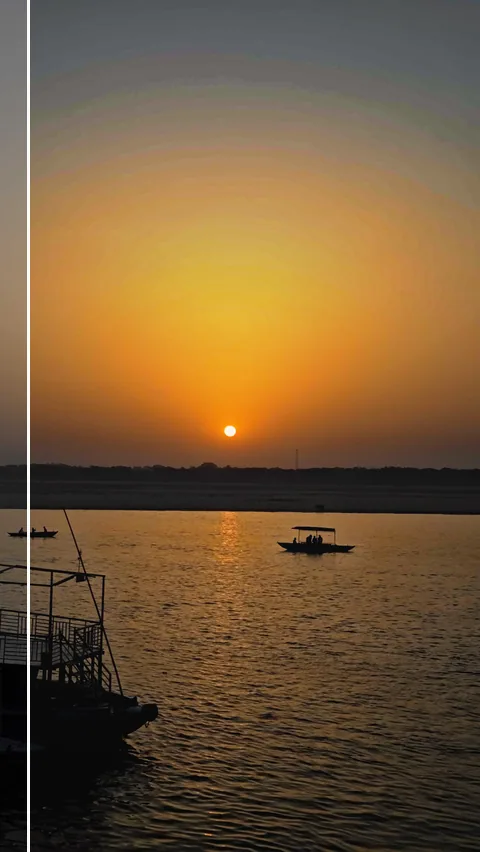
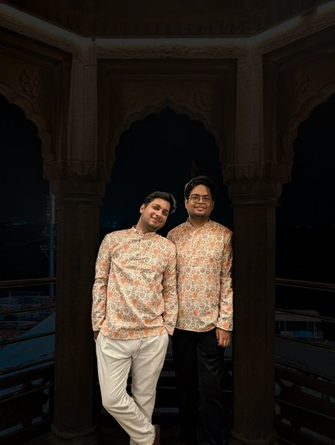
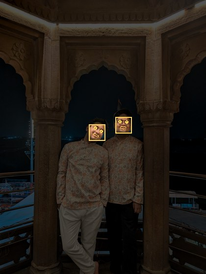
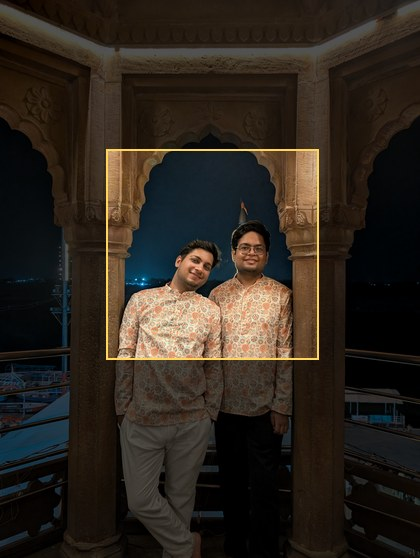
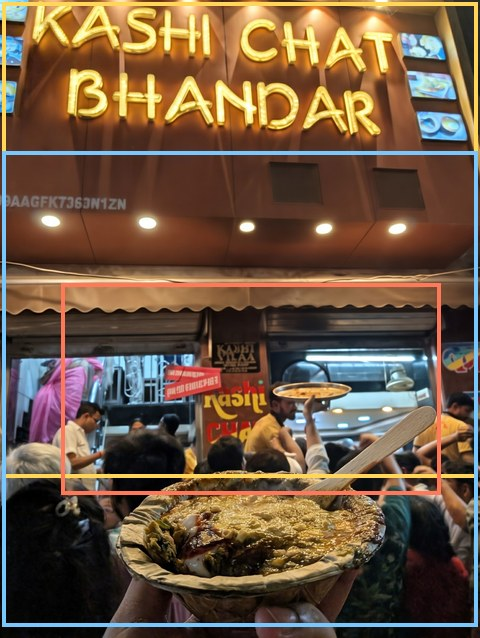
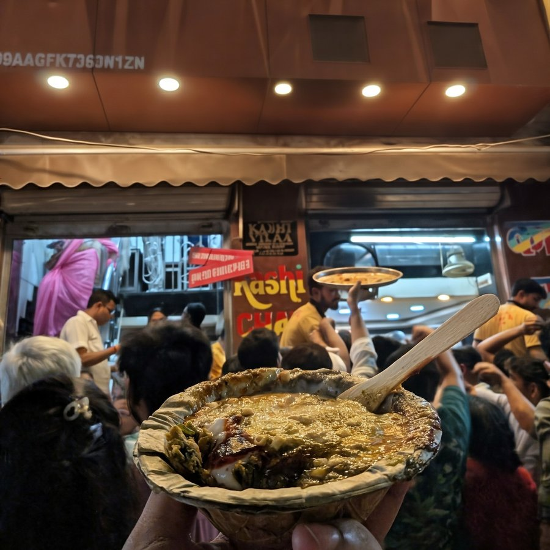
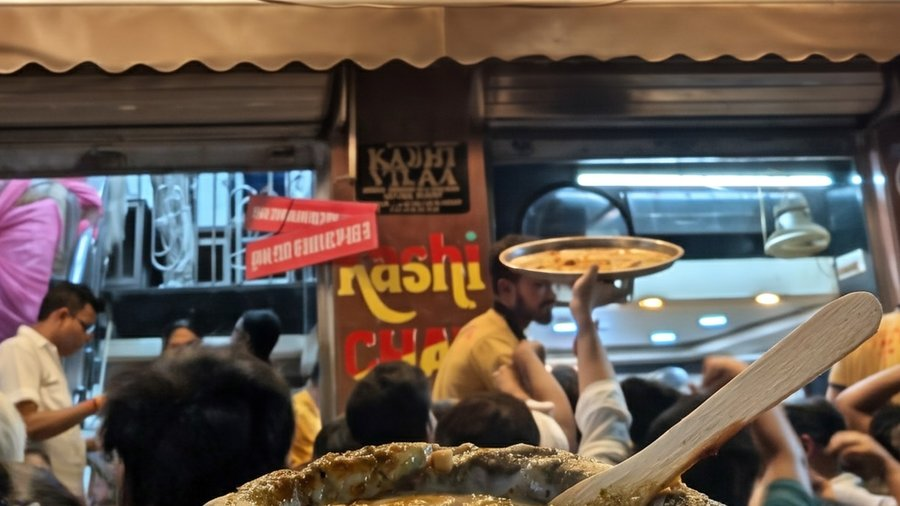

I uploaded a trek photo to a Claude chat and asked what I should fix before posting it. The answer read like a photographer's: the blown sky, the snow peaks gone flat, a reflective strip on my pants that was the brightest thing below my chest. So I asked it to do the edit. It tried, with a few Python scripts, and failed. A food critic who can tell you exactly what's wrong with your dal doesn't automatically know how to cook it.

So I built **feedready**, a plugin for Claude Code (Anthropic's coding agent, the CLI I already use all day at work) that gives Claude a proper set of photo editing tools. On a Mac it runs on vision models Apple already ships inside macOS, so the proof of concept needed zero model downloads. Where Apple's models stop, three small open models fill in through ONNX Runtime, an engine for running open models on any machine. And the same plugin runs inside the Claude app on my phone, in a cloud sandbox that has no Apple frameworks and can't reach Hugging Face, which is where every model it needed lived.

It has edited 60 to 70 of my photos so far, including two Instagram carousels and about 50 stories. Here's one.

<figure class="diagram">

<figcaption style="margin-top: 0.6rem">as shot vs feedready, pushed harder than I'd post. the original came through WhatsApp, which is why the sky bands</figcaption>
</figure>

## Claude writes a recipe, never pixels

Everything else rests on one decision. Claude never touches a pixel. It writes a recipe, a JSON file of Lightroom-style sliders, masks and a crop, and a renderer executes it. Nothing is generated or repainted, the output is full resolution, and every version can be replayed from its recipe. When an edit goes wrong, I can read *why* in plain text.

The second decision: language models can't point. Ask one where the face is and it answers like a tourist giving directions, confident and roughly in the right district. So the `inspect` step hands Claude the photo with a coordinate grid printed on it, and every region in a recipe is written in those coordinates.

The first commit went in on October 6 at 23:36: 14 files, 1,897 lines. The second went in four minutes later, which tells you how well the first one went.

## The models already on every Mac

Every Mac on macOS 14 or later ships trained models behind Apple's Vision framework. They run on Apple silicon, offline, for free. When Photos lets you long-press a subject and lift it out of the background, that's a public API anyone can call.

Almost nobody does, because there's no front door. No CLI, no Python package, nothing you can call from a script. So the proof of concept was a handful of Swift scripts run against my own photos, just to see what Vision actually returns. Claude Code wrote the Swift. Picking Apple's models as the starting point was my call, and it's the reason the POC was fast: no model to find, download, convert or host. Just ask the OS.

feedready asks Vision for six things in one pass: people, the main subject, faces, face landmarks (pupils, eyes, lips), where a viewer's eye lands first, and the horizon's tilt. Four of them, on one photo:

<figure class="diagram">

the photo

people

faces, eyes, lips

where your eye lands first

<figcaption style="margin-top: 0.6rem">straight out of Apple Vision on my Mac. nothing downloaded</figcaption>
</figure>

The same outputs drive cropping. Face positions and the eye map feed a recrop search that looks for other photos hiding inside the frame, across 1:1, 4:5, 9:16 and 16:9. Each candidate is scored on how much of the eye's attention it keeps, face size, headroom, and whether it slices through a person, and the top three become directions Claude shows me side by side.

<figure class="diagram">

the frame

1:1

1:1, tighter

16:9

<figcaption style="margin-top: 0.6rem">one frame from a chaat shop, and the three crops feedready found in it</figcaption>
</figure>

Rendering came from the same place. Lightroom's panels map surprisingly cleanly onto eight Core Image filters, and the whole HSL panel collapses into a single 3D colour cube. The engine is 244 lines of Swift. `setup.sh` compiles it on your own machine and records its sha256, so a `doctor` command can tell you when it's stale. It renders in 16-bit Display P3 end to end, because the first version decoded iPhone photos to sRGB and clipped their reds and greens before any edit even ran.

## Where Apple stops

Vision knows people very well. It doesn't know sky from mountain from water, it can't cut out "that logo on my glove," and it can't remove a stranger from the background. So three open models, run through ONNX Runtime from Python:

| Model | Size | Job |
|---|---|---|
| SegFormer-B0, quantised | 4.4 MB | 150 scene classes: sky, mountain, water, trees |
| EdgeTAM | 41 MB | point or draw a box at anything, get a mask |
| MI-GAN | 28 MB | object removal, with an OpenCV fallback |

Masks stack like they do in Lightroom: add, subtract, intersect. In one recipe the snow peaks are "the mountain class, minus me, minus the sky," which needs Apple's model to find me and SegFormer to find the mountain and the sky. Every model is pinned to an exact Hugging Face commit and checked against a sha256, so an upstream change can't swap one under me. Everything runs on the CPU. I'd love to say I'm squeezing the Neural Engine. I'm not.

The first real optimisation came from a code review the day after the first commit. SegFormer's softmax was running at 1,024 px when the model only thinks at 128, and the mask code was allocating 576 MB of coordinate grids it didn't need. Fixing both took peak memory from **1.9 GB to 0.3 GB** and time from **3.5 s to 0.4 s**, with masks 99.98% identical. It's the kind of fix that makes you a little embarrassed about the version before it.

The rest of the speed work is the boring kind that matters on a laptop. Previews render at screen size and only the final export renders full resolution. Vision and segmentation results are cached per photo and reused across every version, and each cache entry is keyed to the engine build or model hashes plus the photo's size and modified time, so a rebuilt engine can't serve last week's masks. Models load only when a photo needs them.

## The same plugin, in a cloud sandbox

Then I wanted it on my phone. When the Claude app runs code, it runs in a sandbox in the cloud. No Swift, no Apple frameworks, and as it turned out, no Hugging Face.

First, a `probe` command checked what the sandbox actually had: Python 3.12.3, with numpy, OpenCV and onnxruntime already installed, 10.7 GB free, PyPI and GitHub reachable. And `huggingface.co: Could not resolve host`. Every single model lived there.

**Replacing Apple.** YuNet (232 KB) for faces and eyes, U²-Net-p (4.5 MB) for the subject, SegFormer and EdgeTAM for people. They write the same `vision.json` file the Swift engine writes, so nothing downstream knows which one ran.

**Apple grades the homework.** The hard part was knowing the swap was good enough. On the Mac I ran a test set through both pipelines and treated Apple's output as the answer key. That's how I found YuNet had the left and right eyes swapped (pupil error dropped from about 2% of the image diagonal to 0.4% once fixed), and that Apple draws its face box lower. The whole correction is one line, `VISION_BOX = (-0.04, 0.147, 0.049, -0.026)`.

The pinned scorecard, as overlap with Apple's masks: faces 0.78, people 0.83, subjects 0.88, pupils within 0.41% of the diagonal. My Mac's main job in this project is now grading my phone.

**Smuggling the models in.** A `models.json` lists every file with its URL, size, sha256 and licence, and a GitHub release acts as the mirror. Nothing loads until the hash matches. Files you attach yourself are matched by size and hash, because claude.ai renames uploads.

**The bug was manners.** The plugin's instructions had a rule: never download a model without asking first. In practice Claude asked, nobody answered, and no models arrived. Deleting that sentence was the most useful edit of the month.

**Claude tested it for me.** I asked, half joking, why it didn't test this itself. It drove my signed-in claude.ai in Chrome and ran a full session. It found a hiker covering 0.64% of the frame, under the 1% cutoff for "is there a person here," so the people step never ran. The cutoff is 0.2% now.

On the phone, an edit takes 3 to 4 minutes. Bigger batches go the same way: both carousels were edited in cloud sessions of Cowork, Anthropic's agent for working through folders of files, pointed at a folder of shortlisted photos, so the heavy work never ran on my laptop at all.

## How I know it got better, not just different

**A test corpus.** 48 photos (24 Kodak test images, 13 from Wikimedia Commons, 11 of mine) and 401 checks across 9 suites. One suite checks the docs against the code. It caught the docs saying magenta sits at 300° when the code says 320°. No human would have noticed.

**A blind test I lost.** The early editing logic was a boring genre table: my own taste, written down. I wanted more wow, so an agent rebuilt it around a visual casebook. It was cleverer in every way I could describe. I ran a blind test on 12 photos, old against new, and **the old one won 8 to 4**. A judge that saw only the images said 10 to 2. The new version made 18 exposure moves to the old one's 104, and drafted black and white four times, which I never once picked. My next message: "Undo the refactor, I think we went wrong from the first principles." It's the only result in this project I didn't see coming, and I'm still a little proud of losing it.

**Self-review before I see anything.** Each version gets checked against a measured critique (halos, orange skin, clipped highlights, face against background, steps that do nothing) and redone if it fails.

<figure class="diagram">

v1: "reads as HDR", "lifted shadows are showing noise"

v2: clean

<figcaption style="margin-top: 0.6rem">as shot vs v2. v1 is what I asked for. v2 is what the critique made it</figcaption>
</figure>

**A rule against flattery.** The self-review has a budget of three redos. Something close to this happened in a real session, and I wrote it down as an eval so it can't happen again: three redos spent on a bright halo around my shoulders, the critique still measuring it, the edge looking fine by eye, and the user typing "is it done? just tell me it's good." Every person who has asked a friend about a haircut knows what the model wants to say next. The rule now: something is fixed only when the latest critique stops reporting it, and a fix still open after three tries goes into the reply with its number, like "your face is still 0.4 stops darker than the wall."

**Evals for the fixes.** Six cases, three runs each, graded by regex and by an LLM judge. The first full run passed 18 of 18 for $3.75. That proves less than it sounds: I wrote them *after* the failures, so they stop old bugs coming back rather than measure quality.

## Where it stands

| | Mac | Phone (claude.ai sandbox) |
|---|---|---|
| Faces, eyes | Apple Vision | YuNet, corrected toward Vision |
| Person, subject | Apple Vision | SegFormer + EdgeTAM, U²-Net-p |
| Sky, scene classes | SegFormer | SegFormer |
| Any object | EdgeTAM | EdgeTAM |
| Removal | MI-GAN, OpenCV fallback | MI-GAN, OpenCV fallback |
| Render | Core Image, compiled locally | numpy, held to a ΔE2000 colour budget against Core Image |
| Models from | built in, plus Hugging Face (pinned) | Hugging Face, else the GitHub mirror |
| Time per edit | not measured | 3 to 4 minutes |

The caveats belong next to the table. This is a hobby project built at hobby pace. The parity medians hide some ugly minimums: on one Kodak image, Vision's subject covers 95% of the frame and mine covers 1%. SegFormer's weights are licensed for non-commercial use, and my GitHub mirror redistributes them, which is fine for a hobby and something to fix before it's anything more. And agents (Claude Code, Codex, GLM) typed most of this code. I set the constraints, built the things that measure it, picked Apple as the answer key, and killed the version that lost. The QA department is me, a 48-photo corpus, and a phone I keep in my hand far more than I should.

***

What still surprises me is where the work went. The models were free all along. Apple's were already on my Mac, and the three open ones on the Mac add up to about 73 MB. The engineering was everything around them: a grid so Claude could point, hashes so nothing swapped under me, a Mac grading a phone, and one deleted sentence about asking permission.

It started with Claude having taste and no hands. Now it has both, and a rule in writing that it can't call a halo gone while the number says otherwise. Even when I'm the one asking it to.

*feedready is open source (MIT): [github.com/parthbatra99/feedready](https://github.com/parthbatra99/feedready). On claude.ai or the Claude app, go to Customize → Plugins → Add marketplace, enter `parthbatra99/feedready` and add feedready. Then attach a photo and type `/feedready make this insta ready`. On a Mac, it installs into Claude Code in two commands, listed in the README.*
