I uploaded a trek photo to my Claude app and asked what I should fix before posting it on Instagram. The answer read like a photographer's. Blown sky, snow peaks gone flat, and a reflective strip on my pants that was somehow the brightest thing below my chest. So I asked it to just do the edit. It tried, with a bunch of Python and image processing libraries and some bash scripts, and a million tokens later the result was still pretty bad. It was like watching a food critic who can tell you exactly what's wrong with your dal try to cook it.

<figure class="diagram">
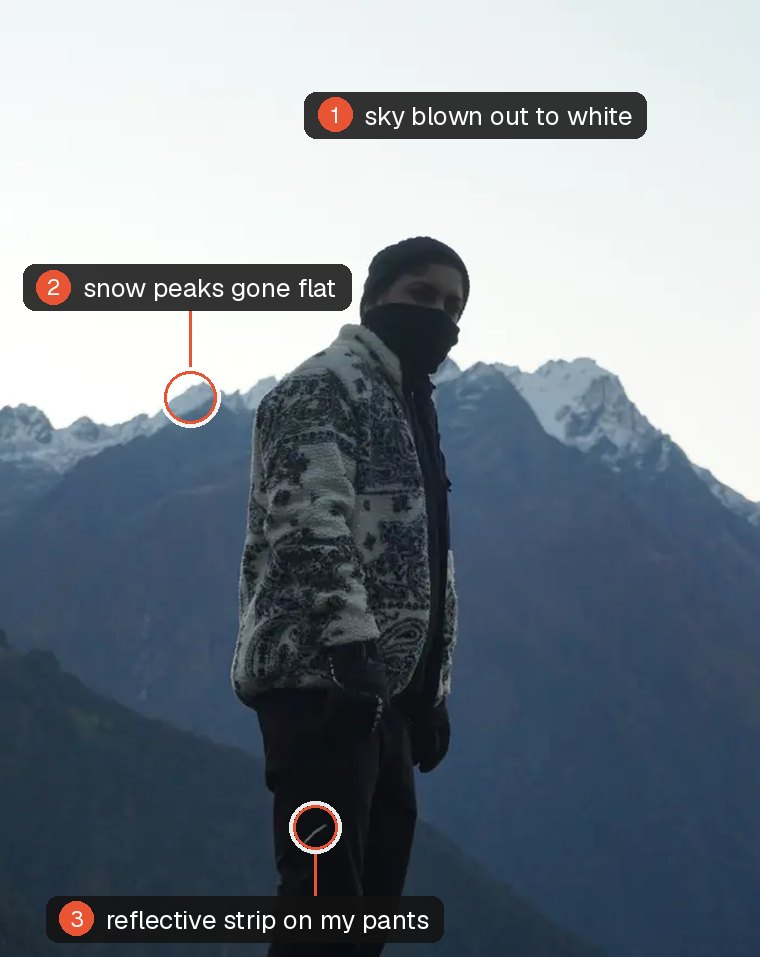
<figcaption style="margin-top: 0.6rem">the photo, and the three things that first chat got right</figcaption>
</figure>

So I built **feedready**. You send Claude a photo and say "make this insta ready". It looks at the photo properly, shows you three looks side by side, and then edits it like a Lightroom editor you hired would. Real sliders, the sky and your face edited separately, a better crop, the random stranger gone. You give notes in normal words ("warmer", "too much", "back to v2") till it's right. It runs in Claude Code on my Mac and in the Claude app on my phone.

It's been through hundreds of my photos by now. A few carousels, a few photo dumps, hundreds of editing sessions. It's on version five or six and it's still not stable, but here's that trek photo after.

<figure class="diagram">
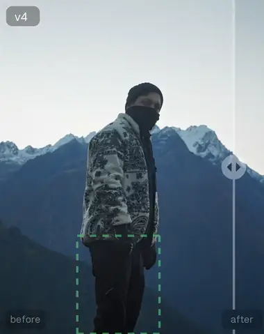
<figcaption style="margin-top: 0.6rem">as shot vs feedready</figcaption>
</figure>

## Claude writes a recipe, never pixels

This is the one idea the whole thing stands on, and I still think it's the coolest part. Claude never touches a pixel. It writes a recipe instead. Exposure down here, sky a bit bluer, this mask for my face, crop like that. Then a small renderer cooks that recipe on the actual photo. So nothing is generated or repainted by AI, your photo stays your photo at full resolution, and every version can be replayed from its recipe, like a saved game.

And because the recipe is just text, it almost never gets stuck. When an edit goes wrong the reason is sitting right there. I can read it, and so can Claude. It finds the bad step, fixes its own recipe (or its own script, sometimes), and still comes back with a final.

<figure class="diagram">

as shot

feedready

<figcaption style="margin-top: 0.6rem">pushed harder than I'd post. the original came through WhatsApp, which is why the sky bands</figcaption>
</figure>

The second problem was that language models can't point. Ask one where the face is and it answers like a tourist giving directions. Confident, roughly the right area, never pixel perfect. So before Claude edits anything, an `inspect` step gives it the photo with a coordinate grid printed on top, plus everything the vision models found, and every region in the recipe is written in those coordinates.

Easier to show than explain. This is a real session, a Ferrari F50 at the Ferrari museum, edited in my Claude app on my phone.

It read the room before touching anything. The car was obviously the subject, but the lilac LED screen behind it was the brightest thing in the frame and its magenta was leaking all over the floor. So it came back with three looks: Clean, Showroom gloss, and Rosso only, where the whole room is drained to almost black and white and the car is the only colour left.

<figure class="diagram">
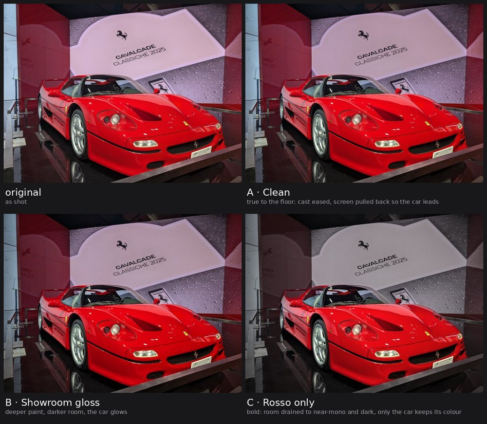
<figcaption style="margin-top: 0.6rem">the board. three looks, rendered, not described</figcaption>
</figure>

I picked Rosso, obviously, and asked it to get rid of the silver rod stands in front of the car. In v3 it removed the stands, the plaques, a "please do not touch" sign and a rail on the left. Its first pass left a faint ghost of the sign's letters on the floor, and it caught that and cleaned it up before showing me. It also refused one thing. Removing the plinth edge across the front bumper would mean making up half the bumper, and it said that's where removal starts looking fake. Fair.

<figure class="diagram">
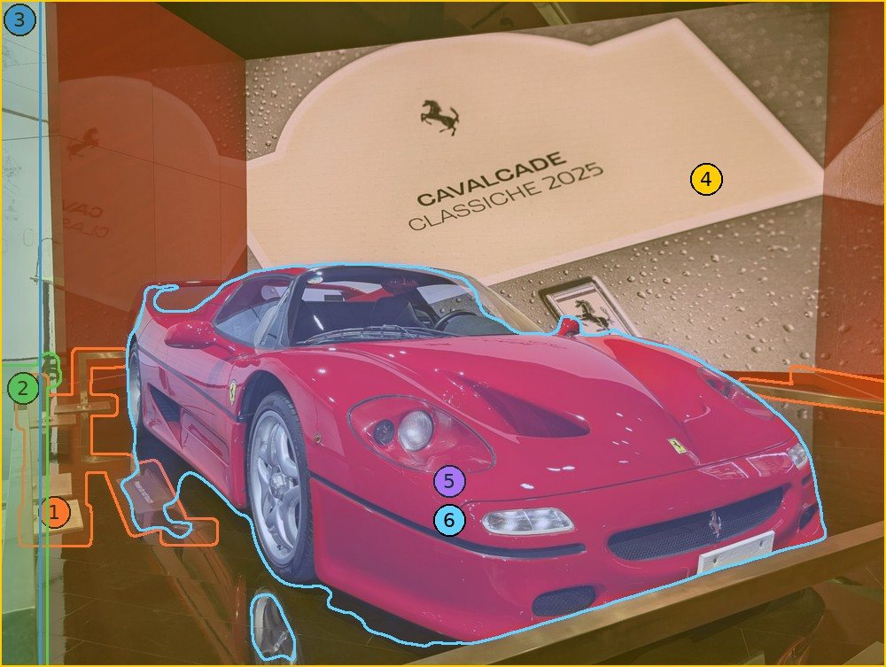
<figcaption style="margin-top: 0.6rem">the v3 map. every region it touched, numbered, drawn from the recipe</figcaption>
</figure>

Then I asked for the front bar to go too. The first try turned the bottom of the bumper grey, because the step that drains colour out of the room thought the freshly filled area was part of the room. It noticed, told that step to leave the area red, and shipped v5.

<figure class="diagram">

<figcaption style="margin-top: 0.6rem">as shot vs v5. if you zoom in, the lower vent got extended a little, because that's what sat behind the bar</figcaption>
</figure>

The first commit for all of this went in at 23:36 on October 6, which is when all good ideas and most bad commits happen. 14 files, 1,897 lines. The second one went in four minutes later, which tells you how well the first one went.

## The models already on every Mac

Every Mac updated since 2023 ships trained models behind Apple's Vision framework. They run on Apple silicon, offline, free. When the Photos app lets you long-press a subject and lift it out of the background, that's a public API anyone can call.

Almost nobody does though, because there's no front door. No command line tool, no Python package, nothing you can call from a script. So the proof of concept was a handful of Swift scripts I wrote and ran on my own photos, just to see what Vision actually gives back. Going with Apple's models first is why the POC was quick. No model to find, download, convert or host. You just ask the OS.

feedready asks Vision for six things in one go: people, the main subject, faces, face landmarks (pupils, eyes, lips), where a viewer's eye lands first, and how tilted the horizon is. Four of them on one photo:

<figure class="diagram">

the photo

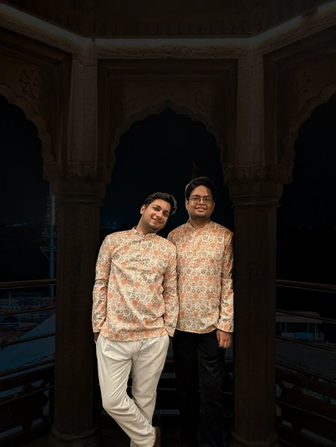people

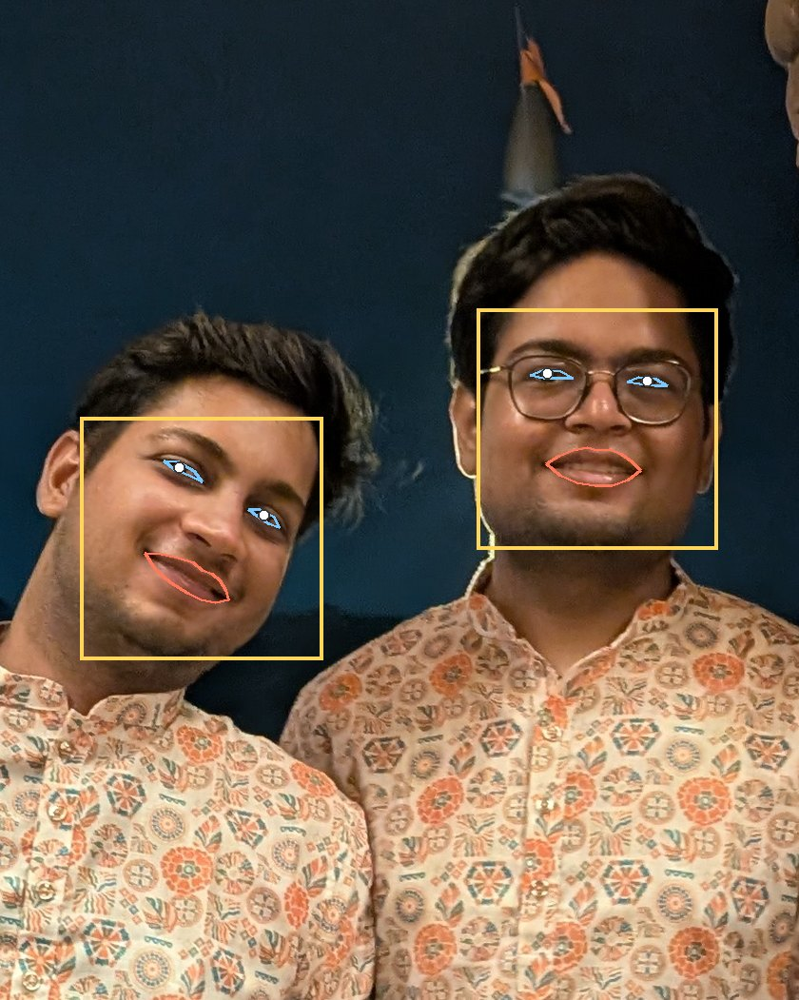faces, eyes, pupils, lips (zoomed in)

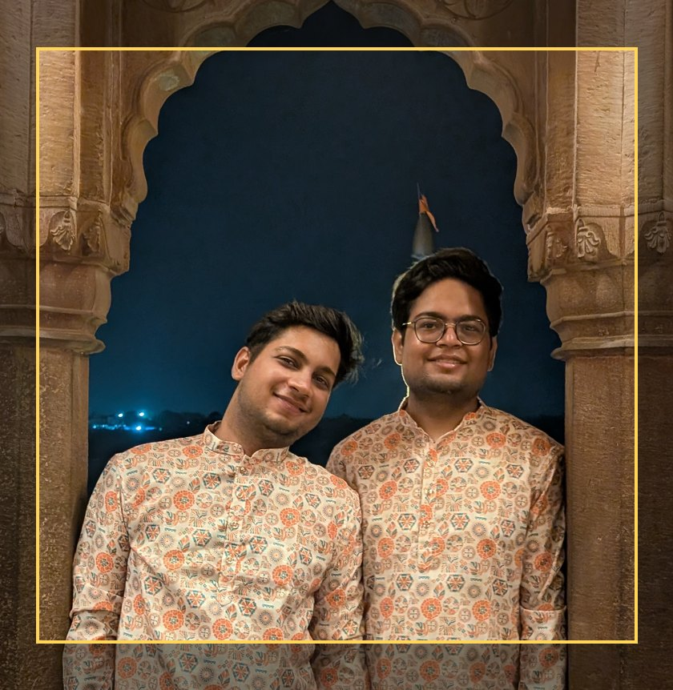where your eye lands first

<figcaption style="margin-top: 0.6rem">straight out of Apple Vision on my Mac. nothing downloaded</figcaption>
</figure>

That same data makes it a better cropper than me, which is a little annoying. It knows where the faces are and where your eye goes first, so it goes hunting for other photos hiding inside the one you took. A square, a 4:5 post, a story, a wide one. Then it judges each one like a picky photo editor would. Did it keep the thing people actually look at? Is the face big enough? Is there room above the head? Did it chop someone in half? The best three come back side by side and I pick.

<figure class="diagram">

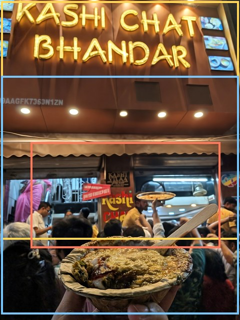the frame

1:1

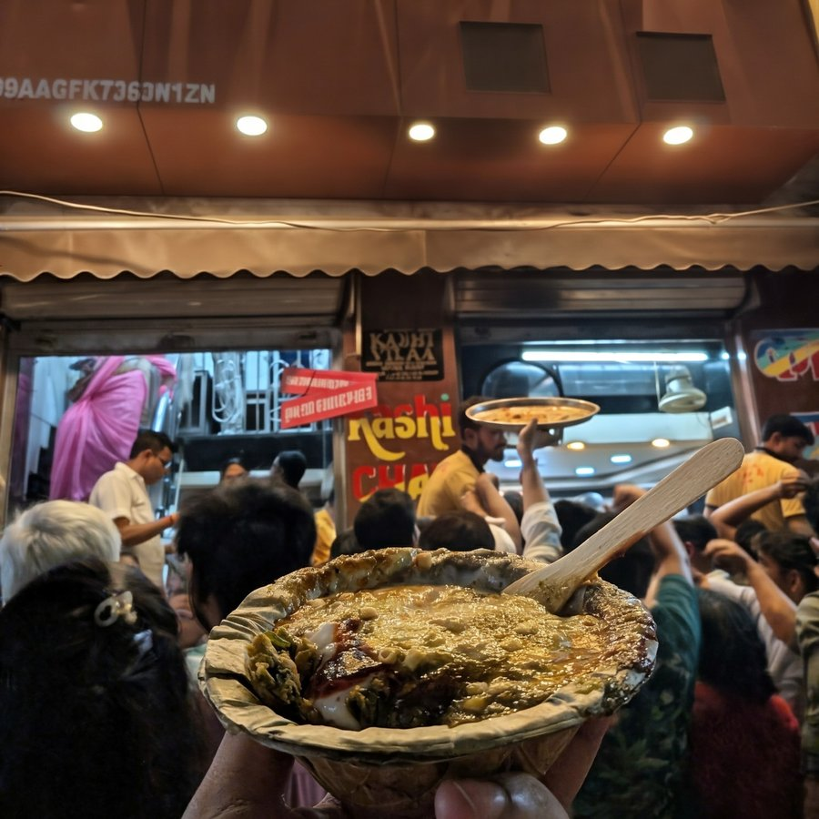1:1, tighter

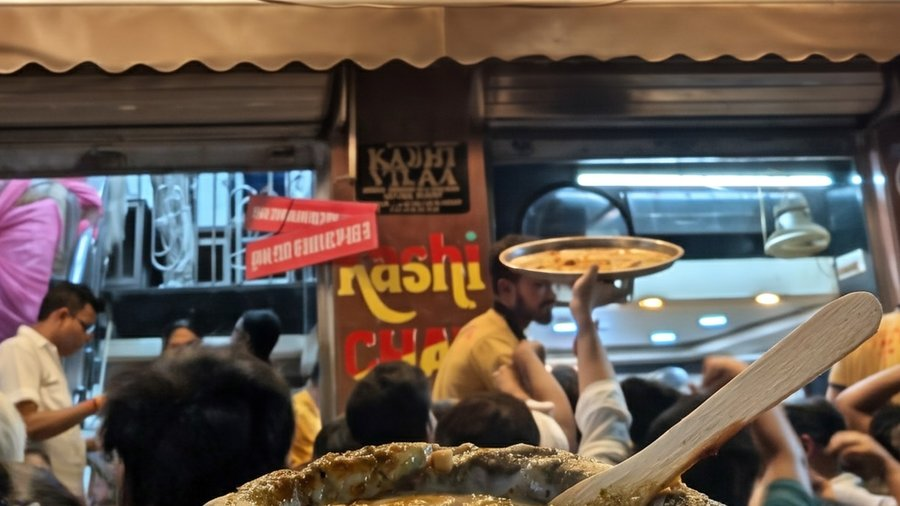16:9

<figcaption style="margin-top: 0.6rem">one frame from a chaat shop, and the three crops feedready found in it</figcaption>
</figure>

Rendering came free with the Mac too. Core Image is Apple's built-in photo engine, the same one the Photos app uses. Turns out most of Lightroom's sliders map to one of eight Core Image filters. The colour panel, where you change only the oranges or only the blues, fits into a single lookup table, basically a cube where every input colour already has its output colour worked out. Setup compiles the small Swift engine on your own Mac and fingerprints it, so feedready knows when it's out of date.

One early bug I'm still a bit embarrassed about. iPhones shoot in a wider range of colour (Display P3) than most images use, and my first version squished every photo into the smaller range the moment it opened it. The brightest reds and greens were already gone before I'd moved a single slider. Now it keeps the wide range start to finish.

## Where Apple stops

Apple's models were never going to be enough. They're great at people. They don't know sky from mountain from water, they can't cut out "that logo on my glove", and they can't remove a stranger from the background. So after the quick POC it was back to the whiteboard.

Thankfully the open source community has small, fast models trained for exactly these kinds of jobs, and they run fine on a laptop. feedready uses three of them, through ONNX Runtime, which is more or less a universal player for models trained anywhere:

| Model | Size | Job |
|---|---|---|
| SegFormer-B0, quantised | 4.4 MB | 150 kinds of scenery: sky, mountain, water, trees |
| EdgeTAM | 41 MB | point or draw a box at anything, get a mask |
| MI-GAN | 28 MB | object removal, with an OpenCV fallback |

None of these is smart on its own, and that's kind of the point. Masks stack like they do in Lightroom: add, subtract, intersect. In one recipe the snow peaks are "the mountain class, minus me, minus the sky", which needs Apple's model to find me and SegFormer to find the mountain and the sky.

This is the same idea behind "code mode" in coding agents, which is having a moment right now. The usual way an agent works is one tool call at a time: call a tool, wait, read the answer, call the next one. In code mode the model writes a few lines of code that call the tools and combine their answers in one shot. A mask recipe is exactly that. Three dumb tools, glued together by something that can write code, end up doing way more than any of them can alone.

<figure class="diagram">
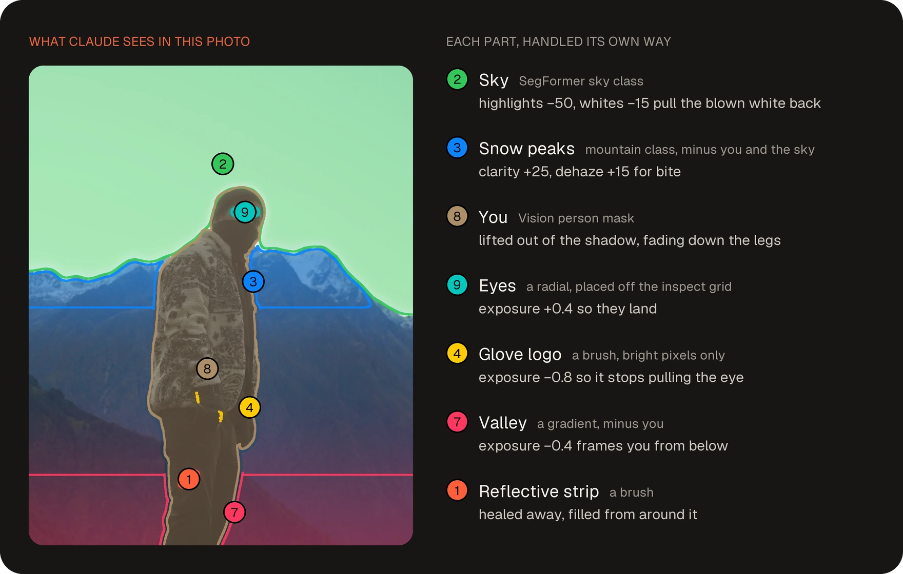
<figcaption style="margin-top: 0.6rem">the trek photo, in parts. each region got its own mask and its own edit. the reflective strip got healed out</figcaption>
</figure>

All of it runs on the CPU. I'd love to say I'm squeezing the Neural Engine. I'm not.

The first real speed fix came from a code review the day after the first commit. SegFormer only thinks in 128 px, but my code was doing its last step at 1,024 px, and the mask code was building 576 MB of scratch data it didn't need at all. Fixing both took peak memory from **1.9 GB to 0.3 GB** and time from **3.5 s to 0.4 s**, with masks 99.98% identical. The kind of fix that makes you a little embarrassed about the version before it.

The rest is simple stuff, and it's what stops my laptop from turning into a heater. While you're still choosing, everything renders at screen size, and only the final export is full size. The expensive part (finding the faces, the sky, the people) runs once per photo and gets saved, so v2 to v9 reuse it for free. Each saved result also remembers which engine and which model made it, and which copy of the photo it came from, so if any of that changes it gets thrown away instead of quietly reused. And a model only loads if the photo needs it. No person in the frame, no people model.

## The same plugin, in a cloud sandbox

This is where most of my real work went, and the part I enjoyed most.

When the Claude app on your phone runs code, it's not running on your phone. Every chat gets its own small, empty Linux computer in the cloud, a sandbox, and it gets thrown away when the chat ends. That sandbox has no Swift and no Apple frameworks, so everything in the last two sections was gone. And as it turned out it couldn't reach Hugging Face either, which is where every single model lived.

**Recon first.** Before writing any phone code I built a `probe` command. You drop it into a fresh sandbox and it reports back what's actually there: which Python, which libraries are already installed, how much disk is free, which websites it can reach, which models it already has. The answer came back as Python 3.12.3, numpy, OpenCV and onnxruntime already installed, 10.7 GB free, PyPI and GitHub reachable. And `huggingface.co: Could not resolve host`. That one report basically decided the whole design.

**Replacing Apple.** No Vision means the phone needs its own eyes. YuNet (232 KB) finds faces and eyes, U²-Net-p (4.5 MB) finds the main subject, and SegFormer plus EdgeTAM find people. They write their answers in exactly the same format the Mac engine does, so nothing after them knows or cares which one ran.

**Apple grades the homework.** The hard part was knowing if the replacements were good enough. So on the Mac I ran the same photos through both and used Apple's answers as the answer key. That's how I found YuNet had the left and right eyes swapped (pupil error dropped from about 2% of the photo's diagonal to 0.4% once I fixed it), and that Apple draws its face box lower than YuNet does. The whole correction is one line, `VISION_BOX = (-0.04, 0.147, 0.049, -0.026)`.

The scorecard, as overlap with Apple's masks where 1.0 would be identical: faces 0.78, people 0.84, subjects 0.84, pupils within 0.41% of the diagonal. My Mac's main job in this project is now grading my phone.

**Smuggling the models in.** Every model had been pinned to an exact version since October 8, two days after the first commit, with a fingerprint (a sha256 hash) for each file. In the sandbox that fingerprint is what makes a backup copy safe to use. A `models.json` lists every file with its address, size, fingerprint and licence, and a GitHub release keeps a copy of each one. The sandbox tries Hugging Face first, falls back to GitHub, and nothing loads until the fingerprint matches the original. You can also attach the files yourself, and they get matched by size and fingerprint, because claude.ai renames uploads.

**The bug was manners.** The plugin's instructions had a rule: never download a model without asking first. Very polite. In practice Claude asked, nobody answered, and no models ever arrived. Deleting that one sentence was the most useful edit of the month. Downloads in the sandbox cost you nothing anyway, they use Anthropic's bandwidth, not your phone's data.

**Then I tested it like a user would.** I had Claude drive my signed-in claude.ai in Chrome and run a full session end to end. It found a hiker covering 0.64% of the frame, under the 1% cutoff for "is there a person here", so the people step never ran. The cutoff is 0.2% now.

On the phone an edit takes 3 to 4 minutes. Bigger batches go the same way: both carousels were edited in cloud sessions of Cowork, Anthropic's agent for working through folders of files, pointed at a folder of shortlisted photos. So the heavy stuff never ran on my laptop at all.

## How I know it got better, not just different

**An eval set.** 48 photos (24 Kodak test images, 13 from Wikimedia Commons, 11 of mine) and 401 checks across 9 suites. One suite checks the docs against the code. It caught the docs saying magenta sits at 300° when the code says 320°. No human would've noticed that.

**Not every new version is better.** I went through every colour grading prompt and skill I could find online, took the best bits of each, and built a 3,000 to 4,000 line skill. My first version, around 250 lines, beat it comprehensively. Blind test on 12 photos, the old one won 8 to 4, and a judge that only saw the images said 10 to 2. My next message was "Undo the refactor, I think we went wrong from the first principles." I'm still a little proud of losing that one.

**Self-review before I see anything.** Every version gets checked against a measured critique (halos, orange skin, clipped highlights, face against background, steps that do nothing) and redone if it fails. It's a small, plain version of the self-improvement loop everyone's excited about right now: the model grades its own work against numbers and redoes it before a human ever sees it. It doesn't improve itself though. It improves the photo.

<figure class="diagram">

v1: "reads as HDR", "lifted shadows are showing noise"

v2: clean

<figcaption style="margin-top: 0.6rem">as shot vs v2. v1 is what I asked for. v2 is what the critique made it</figcaption>
</figure>

**A rule against flattery.** The self-review gets a budget of three redos. Something close to this happened in a real session, so I wrote it down as an eval so it can't happen again: three redos spent on a bright halo around my shoulders, the critique still measuring it, the edge looking fine by eye, and the user typing "is it done? just tell me it's good." Anyone who has asked a friend about a haircut knows what the model wants to say next. The rule now is that something is fixed only when the latest critique stops reporting it, and a fix that's still open after three tries goes into the reply with its number, like "your face is still 0.4 stops darker than the wall."

**Evals for the fixes.** Six cases, three runs each, graded by regex and by an LLM judge. The first full run passed 18 of 18 for $3.75. Which proves less than it sounds, because I wrote them *after* the failures. They stop old bugs from coming back, they don't measure quality.

## Where it stands

It runs on a Mac and on the web (claude.ai and the Claude apps), because that's all I use. There's no Windows version and there won't be one. I don't keep Microsoft products around me. I'm a man of class, and I don't need any more slopware in my life.

| | Mac | Web and the Claude apps |
|---|---|---|
| Faces, eyes | Apple Vision | YuNet, corrected toward Vision |
| Person, subject | Apple Vision | SegFormer + EdgeTAM, U²-Net-p |
| Sky, scenery | SegFormer | SegFormer |
| Any object | EdgeTAM | EdgeTAM |
| Removal | MI-GAN, OpenCV fallback | MI-GAN, OpenCV fallback |
| Render | Core Image, compiled locally | numpy, held to a colour-difference budget against Core Image |
| Models from | built in, plus Hugging Face (pinned) | Hugging Face, else the GitHub mirror |
| Time per edit | not measured | 3 to 4 minutes |

It's a hobby project built at hobby pace, so here's what's on the list for the next versions:

- **The bad days on the phone.** The overlap scores above are medians, and they hide some ugly worst cases. On one Kodak image Vision's subject covers 95% of the frame and mine covers 1%. That gap needs closing.
- **The SegFormer licence.** Its weights are for non-commercial use, and my GitHub mirror redistributes them. Fine for a hobby, but it needs a swap before this is anything more.
- **Stability.** Five or six versions in, it still surprises me some days.
- **Timing on the Mac.** I know it's 3 to 4 minutes on the phone. I've never actually measured the Mac.

Claude Code wrote most of the code for me, with Codex and GLM on some parts. The ideas, the research and the calls were mine: I set the constraints, built the stuff that measures it, picked Apple as the answer key, and killed the version that lost. The QA department is me, a 48-photo eval set, and a phone I keep in my hand way more than I should.

***

What still surprises me is where the work actually went. The models were free all along. Apple's were already on my Mac, and the three open ones add up to about 73 MB. The engineering was everything around them: a grid so Claude could point, fingerprints so nothing swapped under me, a Mac grading a phone, and one deleted sentence about asking permission.

It started with Claude having taste and no hands. Now it has both, and a rule in writing that it can't call a halo gone while the number says otherwise. Even when I'm the one asking it to.

*feedready is open source (MIT): [github.com/parthbatra99/feedready](https://github.com/parthbatra99/feedready). On claude.ai or the Claude app, go to Customize → Plugins → Add marketplace, enter `parthbatra99/feedready` and add feedready. Then attach a photo and type `/feedready make this insta ready`. On a Mac it installs into Claude Code in two commands, listed in the README.*
